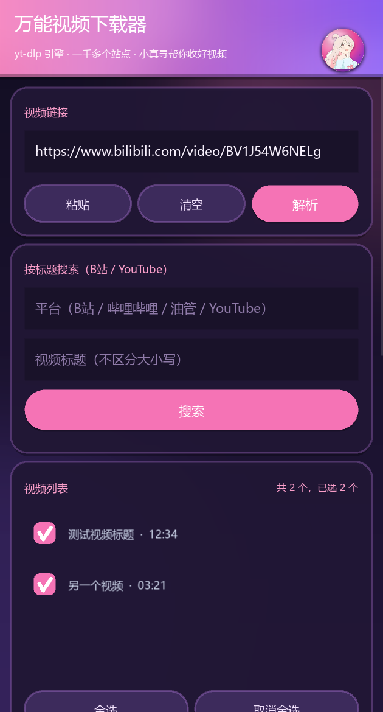

# 万能视频下载器

[](https://github.com/Benicio2026/universal-video-downloader/actions/workflows/build-apk.yml)
[](LICENSE)

Android 视频下载 App。界面用 Kivy 写，下载交给 [yt-dlp](https://github.com/yt-dlp/yt-dlp)。支持 YouTube、Bilibili、X、TikTok 等一千多个站点。

<p align="center">
  
</p>

## 功能

- 粘贴链接后点「解析」，列出页面里的视频条目
- 按标题搜索：输入平台别名（B站/哔哩哔哩/小破站/油管/YouTube 等）和标题，列出结果，显示 UP主、发布时间、时长
- 悬浮嗅探：在别的 App 里复制视频链接，点屏幕上的「寻」气泡，自动回到 App 解析
- 支持从浏览器分享链接到 App，自动填入并解析
- 支持播放列表、合集、多P页面，可勾选单个、多个或全选后批量下载
- 画质：最佳 / 1080p / 720p / 仅音频 MP3
- 内置 FFmpeg：自动合并 DASH 音视频，支持 MP3 转码
- FFmpeg 使用系统库路径启动，避开 Android 上的 OpenSSL 符号冲突
- 内置 QuickJS：处理 YouTube 的 JS challenge，提升可选画质
- 小真寻 3D 徽章作为头部标识和 App 图标，带浮动/光晕动画
- 需要登录时可打开独立登录页，App 不接触账号密码
- 登录 / cookies 收在折叠栏里，遇到需要登录的视频才展开
- 下载目录可以在 App 内选择（内部存储、Download、Movies 等）
- 显示进度、速度、剩余时间，可取消
- 前台下载服务：下载时可退出 App，通知栏常驻；服务失败会自动改用应用内下载重试
- 日志支持手指滚动和一键复制；后台服务出错时可以查看服务日志
- 中文界面，内置中文字体
- 无广告、无内购

## 安装

1. 从 [Releases](https://github.com/Benicio2026/universal-video-downloader/releases) 下载 APK
2. 允许安装未知来源应用
3. 首次启动授予存储权限。Android 11 及以上需要到系统设置里打开“所有文件访问”

华为、荣耀机型如果开启了纯净模式，需要先允许安装外部来源应用。当前 APK 只包含 `arm64-v8a`，近几年的主流手机都是这个架构。

CI 构建使用临时 debug 签名，不同构建之间可能不同；如果覆盖安装提示签名不一致，先卸载旧版再装。

APK 约 48–55 MB（包含 Python、Kivy、yt-dlp、FFmpeg、QuickJS 和中文字体）。

## 使用

1. 在浏览器里复制视频页面链接，或在分享菜单里选择「万能视频下载器」
2. 打开 App，点「粘贴」，再点「解析」
3. 在视频列表里勾选要下载的条目，点「下载选中」
4. 默认保存到 `Download/UniversalVideoDownloader`；在「下载设置」里点「更改」可以选择其他目录
5. 下载失败时先看日志；点「服务日志」可以查看后台服务的详细错误

### 按标题搜索

在「按标题搜索」里填平台和标题，平台支持常见别称且不区分大小写：

- B站：`B站`、`bilibili`、`哔哩哔哩`、`小破站`、`bili`
- YouTube：`YouTube`、`油管`、`yt`

平台留空时优先搜 B站，B站没有结果再试 YouTube。搜索结果会显示 UP主、发布时间和时长；同名视频靠这些信息区分。目前只支持 B站和 YouTube 的标题搜索，其他平台请粘贴链接。

### 悬浮嗅探

点「悬浮嗅探」并授予「显示在其他应用上层」权限后，屏幕上会出现一个「寻」气泡：

1. 在 B站等 App 里复制视频链接
2. 点「寻」气泡，App 会自动打开、读取剪贴板并解析
3. 长按气泡可以关闭悬浮嗅探

悬浮嗅探只在点击气泡时读取剪贴板，不会在后台持续读取屏幕内容，也不需要无障碍权限。服务启动后会自动校验是否创建了气泡；如果没有，会弹 Toast 提示，点「服务日志」可以看到 `sniffer.log` 里的具体原因。

App 不单独设置代理。手机开启全局/TUN 模式的代理后，yt-dlp 会自动走系统网络。

浏览器插件（比如猫抓）靠在页面里嗅探视频请求。这个 App 把链接交给 yt-dlp 解析，支持 yt-dlp 收录的站点；使用时需要先复制链接，少了在网页里直接点一下的步骤。悬浮嗅探和分享菜单能把“复制链接”这一步变得更顺手。

## 登录内容

有些视频需要登录才能访问。登录 / cookies 默认收在折叠栏里，遇到需要登录的视频时会自动展开并询问：

- 同意后会在 App 内打开一个独立的站点登录页，登录完成后点「完成登录」。App 不接触账号密码，只保存 cookies。
- 也可以导入浏览器导出的 `cookies.txt`。
- 不想登录时，App 会明确提示该视频无法下载。

登录页是独立的 Android Activity，不叠加在 Kivy 窗口上，避免卡死或闪退。cookies 只保存在本机，不会上传。Google 账号可能被登录页限制，建议使用 cookies.txt 兜底。

## 支持的站点

完整列表见 yt-dlp 的 [supportedsites.md](https://github.com/yt-dlp/yt-dlp/blob/master/supportedsites.md)。Netflix、Disney+ 这类 DRM 保护的流媒体不在支持范围内。

## 已知限制

- 已内置 FFmpeg，可以合并高清 DASH 音视频并转 MP3。个别站点下不到最高画质时，通常是因为需要登录或站点解析限制。
- 已提供 App 内独立登录页；Google 系账号可能被登录页拒绝，可用 cookies.txt 兜底。
- 已实现前台下载服务：下载时可以退出 App，通知栏常驻。部分国产系统的省电策略仍可能限制后台服务，必要时在系统设置里允许本应用自启动/后台运行。
- 服务下载失败时，App 会自动改用应用内下载重试；仍然失败时，日志里会保留具体错误，点「服务日志」可看后台服务日志。
- 已内置 QuickJS 处理 YouTube 的 JS challenge；个别视频仍可能受 YouTube 客户端策略影响。
- 按标题搜索目前支持 B站和 YouTube；B站搜索会受站点风控影响，失败时请改用链接。
- 悬浮嗅探需要「显示在其他应用上层」权限，并且需要先复制视频链接再点气泡；它不做无障碍读屏，也不会后台持续读取屏幕。
- 当前只构建了 `arm64-v8a`，32 位老手机无法安装。

## 自己构建

GitHub Actions 会在推送 `main` 或 `v*` 标签时构建 APK。公开仓库的 Actions 免费，构建和 Releases 分发都不产生费用。

```bash
git tag v0.9.4
git push origin v0.9.4
```

本地构建需要 Linux 或 WSL，Windows 不能直接运行 Buildozer：

```bash
sudo apt install -y git zip unzip openjdk-17-jdk \
  autoconf libtool pkg-config zlib1g-dev \
  libncurses5-dev libncursesw5-dev libtinfo5 \
  cmake libffi-dev libssl-dev libltdl-dev
python3 -m pip install --user buildozer cython
python3 scripts/fetch_font.py
buildozer -v android debug
```

产物在 `bin/` 目录。

## 项目结构

```text
universal-video-downloader/
├── main.py                    # Kivy 界面和下载逻辑
├── app.kv                     # 界面布局
├── service.py                 # Android 前台下载服务
├── sniffer_service.py         # 悬浮嗅探服务
├── java/.../LoginActivity.java # 独立登录页
├── buildozer.spec             # Android 打包配置
├── local_recipes/kivy/        # Kivy recipe override（去掉 requests 依赖）
├── scripts/fetch_font.py      # 构建前下载中文字体
├── scripts/build_ffmpeg.sh    # 构建静态 FFmpeg
├── scripts/build_quickjs.sh   # 构建 QuickJS-ng
├── assets/fonts/              # 字体和许可证（字体构建时下载）
├── intent_filters.xml         # 浏览器分享接收
├── mascot.png                 # 界面小吉祥物
├── icon.png
├── screenshot.png
├── requirements.txt
├── THIRD_PARTY_NOTICES.md
└── .github/workflows/build-apk.yml
```

## 常见问题

**安装时被拦截？** 允许安装未知来源应用；华为、荣耀机型先关闭纯净模式。

**提示需要登录？** 按弹窗提示导入浏览器导出的 `cookies.txt`，然后重新点「解析」；不登录就下载不了这类视频。

**下载报 403 或 “Sign in to confirm you're not a bot”？** 先确认手机代理已开启且为全局/TUN 模式；仍不行时导入 cookies.txt 后重试。

**下载不到最高画质？** 先确认该视频是否需要登录；需要时导入 cookies.txt。DRM 站点仍然不支持。

**文件保存在哪？** 默认在 `Download/UniversalVideoDownloader`。可以在「下载设置」里点「更改」选择其他目录；如果没有授予“所有文件访问”，部分目录可能不可写。

遇到问题可以在 [Issues](https://github.com/Benicio2026/universal-video-downloader/issues) 里反馈。

## 致谢

- [yt-dlp](https://github.com/yt-dlp/yt-dlp)：解析和下载
- [yt-dlp-ejs](https://github.com/yt-dlp/ejs)：YouTube JS challenge 脚本
- [FFmpeg](https://ffmpeg.org/)：音视频合并和 MP3 转码
- [QuickJS-ng](https://github.com/quickjs-ng/quickjs)：处理 YouTube JS challenge
- [LAME](https://lame.sourceforge.io/)：MP3 编码
- [Kivy](https://kivy.org/)：界面
- [python-for-android](https://github.com/kivy/python-for-android)、[Buildozer](https://github.com/kivy/buildozer)：APK 打包
- [Noto Sans CJK](https://github.com/notofonts/noto-cjk)：中文字体

## 许可

MIT，见 [LICENSE](LICENSE)。第三方组件许可见 [THIRD_PARTY_NOTICES.md](THIRD_PARTY_NOTICES.md)。

## 免责声明

请只下载你有权保存的内容，遵守目标网站的服务条款和当地法律。这个项目不绕过 DRM。
